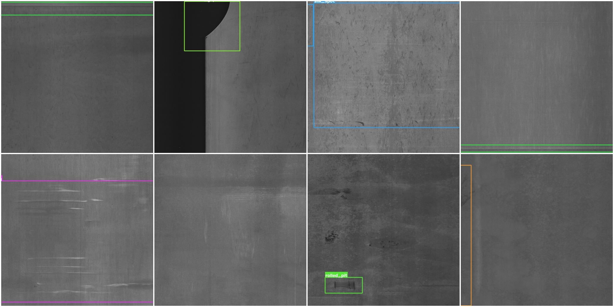

---
language:
- en

license: cc-by-4.0

pretty_name: GC10-DET Metallic Surface Defect Detection Dataset

task_categories:
- object-detection

tags:
- object-detection
- industrial
- surface-defect-detection
- metallic-surface
- quality-inspection
- computer-vision
- ultralytics
- yolo

size_categories:
- 1K<n<10K

configs:
- config_name: default
  data_files:
  - split: train
    path: data/images/train/metadata.jsonl
  - split: validation
    path: data/images/valid/metadata.jsonl
  - split: test
    path: data/images/test/metadata.jsonl
---

<h1 align="center">GC10-DET: Metallic Surface Defect Detection Dataset (Object Detection)</h1>

<p align="center">
  
</p>


> **Unofficial redistribution of the GC10-DET metallic surface defect detection dataset, reformatted into a standardized YOLO-compatible directory layout with a deterministic train/val/test split.**

## Dataset Description

- **Homepage:** https://github.com/lvxiaoming2019/GC10-DET-Metallic-Surface-Defect-Datasets
- **Repository:** https://github.com/lvxiaoming2019/GC10-DET-Metallic-Surface-Defect-Datasets
- **Paper:** https://doi.org/10.3390/s20061562
- **Point of Contact:** Lvxiaoming1@gmail.com

## Disclaimer

This repository is **not** an official release of the GC10-DET dataset.

GC10-DET was created by Xiaoming Lv, Fajie Duan, Jia-jia Jiang, Xiao Fu, and Lin Gan (Tianjin University), who retain all copyright and intellectual property rights. This repository does **not** claim ownership of any images, annotations, or metadata.

This repository exists for two purposes:

1. To reorganize the dataset into a standardized YOLO/Ultralytics-compatible directory structure that can be used directly by many modern object detection training pipelines.
2. To provide a more reliable download source with a **defined train/val/test split**, since the original release ships as a single undivided folder.

**Two-hop provenance.** This redistribution is not sourced directly from the original authors' raw distribution. It is sourced from the [Dataset Ninja](https://datasetninja.com/gc10-det) export of GC10-DET, which repackaged the original Baidu-hosted release into a per-image Supervisely-JSON format. This repository converts that export to YOLO format and applies a deterministic split. Both the original authors and the intermediate distributor are credited below.

---

# Dataset Overview

GC10-DET is an industrial surface-inspection benchmark: grayscale images of rolled steel sheet surfaces exhibiting 10 common manufacturing defect types, with box-level annotations. It is used to benchmark defect localization for automated quality control.

The original paper reports 3,570 images collected; the released detection set (what Dataset Ninja distributes and this repository is built from) contains **2,300 images with 3,563 annotated boxes**. Images are single-channel (grayscale) and vary in size (commonly 2048x1000). Some images carry more than one defect type.

This repository preserves every image and box while re-encoding the labels for YOLO compatibility and adding a reproducible split (see [Changes from the Official Release](#changes-from-the-official-release) below).

---

# Changes from the Official Release

### 1. Original release &rarr; Dataset Ninja Supervisely export (not performed by this repository)

Dataset Ninja repackaged the original GC10-DET release into per-image Supervisely-JSON annotations (`ds/ann/<image>.json`, axis-aligned rectangles). This step was **not** performed by us; we redistribute a converted form of its output.

### 2. Dataset Ninja export &rarr; this repository

- **Train/val/test split created.** GC10-DET ships with **no official split**. This repository applies a **deterministic seeded 80/10/10 split** (`random.Random(42)` over the sorted image list): train 1,840 / valid 230 / test 230. It is fully reproducible; regenerate with a different seed or ratio if you need to match another split.
- **Annotation format converted.** Supervisely rectangles (`points.exterior` corner pairs) were converted to YOLO's normalized `class x_center y_center width height` `.txt` format (one line per box), and to a canonical COCO JSON per split. Corner pairs were normalized to `(min, max)` order; no box coordinates were otherwise altered.
- **One class title normalized.** The Supervisely class title `waist folding` is written as `waist_folding`, for consistency with the other nine underscore-style names. No class was merged, added, or removed (10 &rarr; 10).
- No image pixel content was modified. No boxes were added or removed.
- A small number of images (~8) have no annotated defect in the source export; they are kept with an empty label file rather than dropped.

---

# Dataset Structure

```text
<repo>/
├── README.md
├── gc10det_banner.jpg
└── data/
    ├── data.yaml
    ├── images/
    │   ├── train/   (1,840 *.jpg)
    │   ├── valid/   (230 *.jpg)
    │   └── test/    (230 *.jpg)
    └── labels/
        ├── train/   (1,840 *.txt)
        ├── valid/
        └── test/
```

where:

* `data/images/<split>/` contains the grayscale steel-surface images for each split.
* `data/labels/<split>/` contains one YOLO-format `.txt` annotation file per image (`class x_center y_center width height`, normalized; empty for images with no annotated defect).
* `data/data.yaml` is the Ultralytics dataset configuration file (class names, split paths, relative to `data/`).
* Splits: **train** 1,840 images / 2,848 boxes &middot; **valid** 230 images / 349 boxes &middot; **test** 230 images / 366 boxes (2,300 images / 3,563 boxes total).

### Classes (10)

| id | class name    | boxes (approx.) |
|----|---------------|-----------------|
| 0  | crease        | 74              |
| 1  | crescent_gap  | 265             |
| 2  | inclusion     | 347             |
| 3  | oil_spot      | 569             |
| 4  | punching_hole | 329             |
| 5  | rolled_pit    | 85              |
| 6  | silk_spot     | 884             |
| 7  | waist_folding | 143             |
| 8  | water_spot    | 354             |
| 9  | welding_line  | 513             |

Class distribution is imbalanced: **silk_spot** is the most common defect (~880 boxes) while **crease** and **rolled_pit** are the rarest (~10x fewer). Per-class metrics on the minority classes are measured on very few examples.

---

# Dataset Sources

## Original Paper

**Deep Metallic Surface Defect Detection: The New Benchmark and Detection Network**

Xiaoming Lv, Fajie Duan, Jia-jia Jiang, Xiao Fu, Lin Gan

*Sensors*, 20(6):1562, 2020. DOI: [10.3390/s20061562](https://doi.org/10.3390/s20061562) &middot; [PMC7146379](https://www.ncbi.nlm.nih.gov/pmc/articles/PMC7146379/)

## Official Resources

- **Official Repository:** https://github.com/lvxiaoming2019/GC10-DET-Metallic-Surface-Defect-Datasets
- **Kaggle mirrors:** https://www.kaggle.com/datasets/alex000kim/gc10det &middot; https://www.kaggle.com/datasets/lirick/gc10-det

## Intermediate Export

- **Dataset Ninja:** https://datasetninja.com/gc10-det

---

# Attribution

**All credit for the dataset belongs entirely to the original GC10-DET authors: Xiaoming Lv, Fajie Duan, Jia-jia Jiang, Xiao Fu, and Lin Gan (Tianjin University).**

Credit for the Supervisely-format repackaging used as the direct source for this repository belongs to Dataset Ninja.

This repository only reformats that export into a YOLO layout and adds a deterministic train/val/test split, for improved usability and reproducibility.

If you use this dataset in your research, **please cite the original publication below.**

---

# License

GC10-DET is catalogued and redistributed under **Creative Commons Attribution 4.0 International (CC BY 4.0)**, as stated in the `LICENSE.md` of the Dataset Ninja distribution this repository is built from.

Accordingly:

- Attribution to the original creators is required.
- Commercial and non-commercial use are both permitted.
- No share-alike obligation (derivative works are not required to use the same license).

**A note on verification.** The original authors' GitHub repository does not include an explicit license file; CC BY 4.0 is the license under which GC10-DET is distributed via Dataset Ninja and is the best available evidence. If you require certainty for commercial use or further redistribution, we recommend contacting the original authors directly.

This repository is distributed under the same terms as its direct source (CC BY 4.0).

---

# Citation

If you use this dataset, please cite:

```bibtex
@article{lv2020deep,
  title = {Deep Metallic Surface Defect Detection: The New Benchmark and Detection Network},
  author = {Lv, Xiaoming and Duan, Fajie and Jiang, Jia-jia and Fu, Xiao and Gan, Lin},
  journal = {Sensors},
  volume = {20},
  number = {6},
  pages = {1562},
  year = {2020},
  publisher = {MDPI},
  doi = {10.3390/s20061562}
}
```

---

# Acknowledgements

We sincerely thank Xiaoming Lv, Fajie Duan, Jia-jia Jiang, Xiao Fu, and Lin Gan for creating and publicly releasing this valuable industrial surface-defect benchmark, and Dataset Ninja for the Supervisely-format repackaging this repository builds on.
